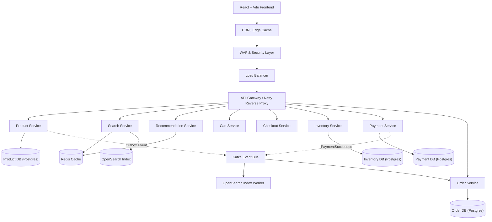

# SALESTORM High-Level Architecture (HLD)

## 1. System Overview

SALESTORM is an enterprise-grade flash-sale platform designed to process **10,000+ concurrent purchase attempts** against extremely constrained inventory (e.g. 100 units) with **ZERO overselling**.

## 2. High-Level Architecture Diagram

## 3. Core Microservices

| Service | Primary Responsibility | Data Store |
| :--- | :--- | :--- |
| **API Gateway** | Routing, rate limiting, request validation | In-memory token bucket |
| **Product Service** | Authoritative product catalog & outbox events | PostgreSQL (`salestorm_product`) |
| **Search Service** | Read-model search, filter, sort, pagination | OpenSearch + Redis |
| **Inventory Service** | Atomic SQL stock reservation & 10m TTL expiry | PostgreSQL (`salestorm_inventory`) |
| **Payment Service** | Idempotent payment charges & timeout reconciliation | PostgreSQL (`salestorm_payment`) |
| **Order Service** | Order lifecycle state machine & event consumer | PostgreSQL (`salestorm_order`) |
| **Recommendation Service** | Weighted recommendation scoring algorithm | Redis |
