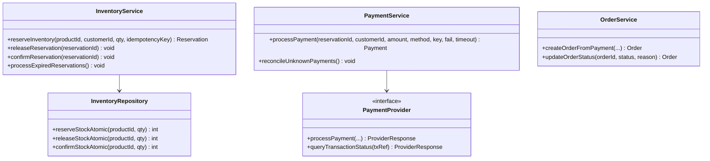

# SALESTORM Low-Level Architecture (LLD) & Class Diagrams

## 1. Inventory Concurrency Engine

The core invariant `SUCCESSFUL RESERVATIONS MUST NEVER EXCEED AVAILABLE INVENTORY` is enforced via an **Atomic Conditional SQL Update**:

```sql
UPDATE inventory
SET available_quantity = available_quantity - :quantity,
    reserved_quantity = reserved_quantity + :quantity,
    version = version + 1
WHERE product_id = :productId
  AND available_quantity >= :quantity;
```

Row count evaluation:
- `rowsAffected == 1` → Reservation succeeds.
- `rowsAffected == 0` → Stock exhausted; returns `409 OUT_OF_STOCK`.

## 2. Class Diagram


