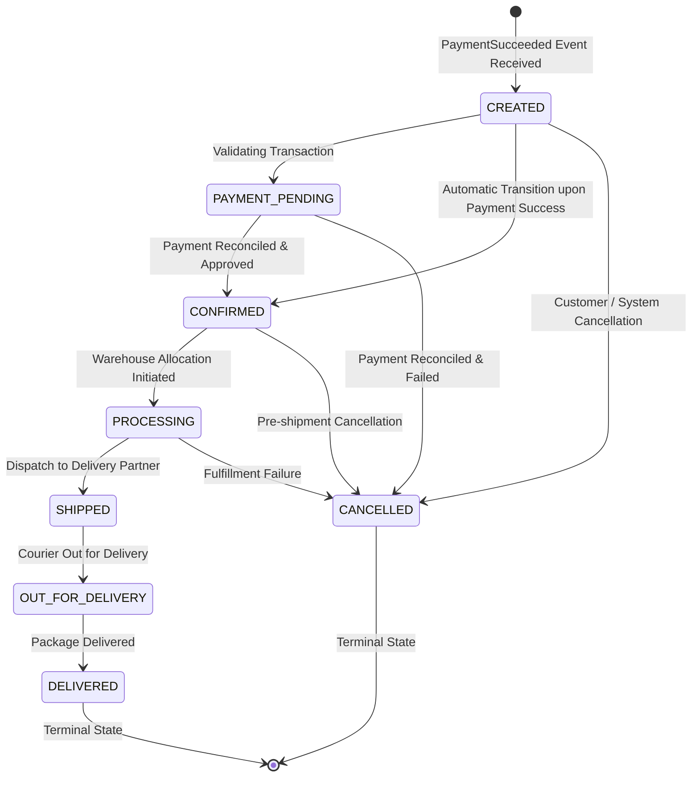

# Order State Machine Diagram

## State Transition Rules (`OrderStatus.java`)
- `CREATED` can transition to: `PAYMENT_PENDING`, `CONFIRMED`, `CANCELLED`.
- `CONFIRMED` can transition to: `PROCESSING`, `CANCELLED`.
- `PROCESSING` can transition to: `SHIPPED`, `CANCELLED`.
- `SHIPPED` can transition to: `OUT_FOR_DELIVERY`.
- `OUT_FOR_DELIVERY` can transition to: `DELIVERED`.
- `DELIVERED` & `CANCELLED` are terminal states (no further transitions allowed). Invalid transitions throw `IllegalStateException`.
