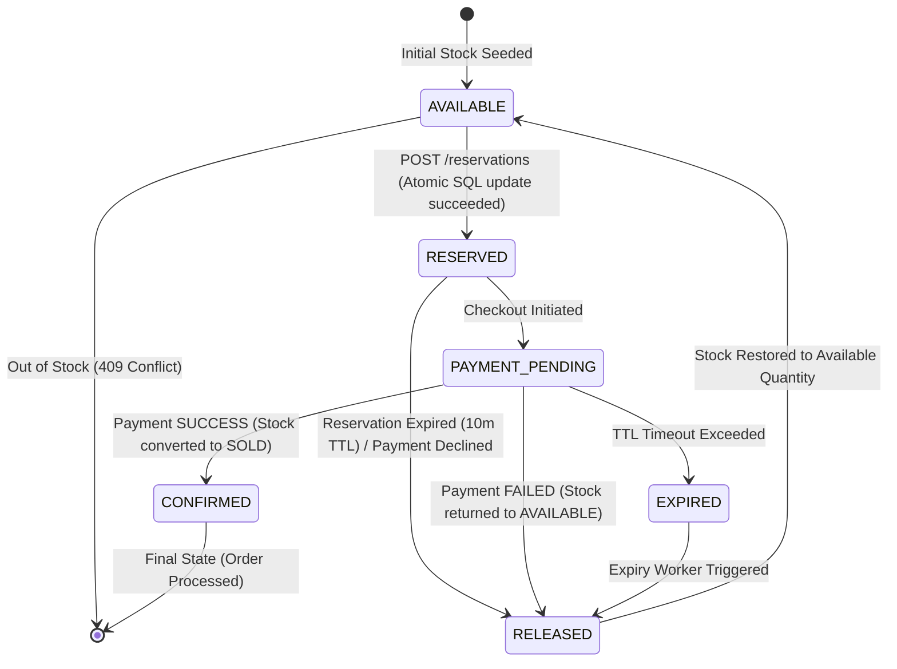

# Reservation State Lifecycle Diagram

## State Descriptions
1. **AVAILABLE**: Stock is available for reservation in PostgreSQL inventory table (`available_quantity > 0`).
2. **RESERVED**: Stock atomically reserved for a customer with an expiration timestamp (`expires_at = now + 10m`).
3. **PAYMENT_PENDING**: Customer initiated payment gateway charge.
4. **CONFIRMED**: Payment approved. Reserved quantity converted to `sold_quantity`.
5. **RELEASED / EXPIRED**: Payment failed or 10-minute TTL expired. Stock returned atomically to `available_quantity`.
