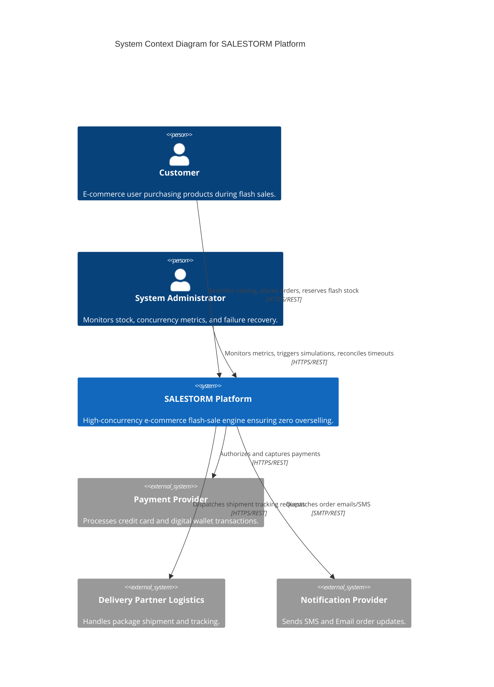

# SALESTORM System Context Diagram (C4 Level 1)

## System Context Diagram

## System Boundaries & Interaction Description
- **Customer**: Interacts synchronously via HTTPS for search, cart management, inventory reservation, and checkout.
- **Payment Provider**: External payment gateway (simulated via `MockPaymentProvider` with timeout reconciliation).
- **Delivery Partner**: External logistics API for shipment creation.
- **Notification Provider**: Email/SMS notifications triggered asynchronously via domain events.
